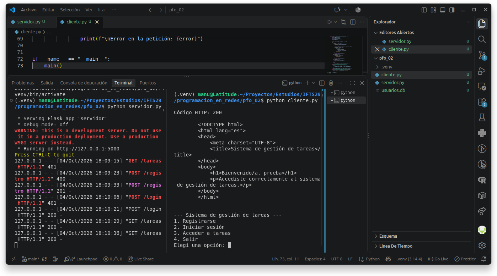

# PFO 2 — Sistema de Gestión de Tareas con API y Base de Datos

Materia: Programación en Redes — IFTS N.º 29
Alumno: Manuel Alejandro Espíndola

## Descripción

Aplicación cliente-servidor que permite registrar usuarios, iniciar
sesión y acceder a una página HTML de bienvenida protegida.

El servidor utiliza Flask y SQLite. El cliente de consola se comunica
con la API mediante peticiones HTTP y conserva la cookie de sesión.

## Requisitos

- Python 3.
- Dependencias indicadas en requirements.txt.

## Instalación y ejecución en Ubuntu

Desde la carpeta del proyecto:

```bash
python3 -m venv .venv
source .venv/bin/activate
python -m pip install -r requirements.txt
python servidor.py
```

El servidor escucha en http://127.0.0.1:5000.
La base usuarios.db y su tabla se crean automáticamente.

En una segunda terminal, desde la misma carpeta:

```bash
source .venv/bin/activate
python cliente.py
```

Ambos programas deben estar funcionando al mismo tiempo.

## Cómo probarlo

1. Elegir la opción 3 sin iniciar sesión: devuelve HTTP 401.
2. Elegir la opción 1 e ingresar un usuario nuevo y una contraseña:
   devuelve HTTP 201.
3. Elegir la opción 2 con las credenciales registradas:
   devuelve HTTP 200.
4. Elegir la opción 3: devuelve HTTP 200 y el HTML de bienvenida.
5. Elegir la opción 4 para salir.

La contraseña no se muestra mientras se escribe.

El cliente muestra el HTML como texto en la consola.
La sesión del cliente es independiente de la del navegador.

## Endpoints

| Método | Ruta | Función |
|---|---|---|
| POST | /registro | Registrar un usuario con contraseña hasheada. |
| POST | /login | Verificar credenciales e iniciar sesión. |
| GET | /tareas | Mostrar una bienvenida si existe una sesión válida. |

Registro y login reciben un objeto JSON con este formato:

```json
{"usuario": "prueba", "contraseña": "1234"}
```

## Evidencia de pruebas

La captura muestra el registro exitoso, el inicio de sesión y el
acceso autorizado a la bienvenida. También muestra solicitudes rechazadas.



## ¿Por qué hashear contraseñas?

Guardar contraseñas en texto plano permitiría que alguien con acceso
a la base de datos pudiera leerlas directamente. Por eso se almacena
un hash generado por Werkzeug, con una sal aleatoria.

Al iniciar sesión, se verifica la contraseña ingresada contra el
hash guardado. No se recupera ni se descifra la contraseña original.
Esto reduce el riesgo ante una filtración, aunque no elimina la
posibilidad de ataques para adivinar contraseñas débiles.

## Ventajas de usar SQLite en este proyecto

SQLite no requiere instalar ni administrar un servidor de base de
datos. Guarda la información en un archivo local y Python incluye
el módulo necesario para utilizarla.

Permite conservar los usuarios entre ejecuciones y utilizar SQL,
restricciones de unicidad y transacciones. Es adecuado para el
alcance y el volumen de datos de este trabajo práctico.

## Publicación

GitHub contiene el código fuente y la documentación.
GitHub Pages presenta el proyecto y las evidencias de las pruebas.

El servidor Flask se ejecuta localmente siguiendo estas instrucciones,
ya que GitHub Pages aloja contenido estático y no ejecuta Python.

## Alcance

Se implementan registro, inicio de sesión y bienvenida protegida.
Como la consigna no solicitaba operaciones de alta, edición o eliminación
de tareas no se implemento.

La clave de sesión se genera al arrancar el servidor. Por ello,
al reiniciarlo hay que volver a iniciar sesión.